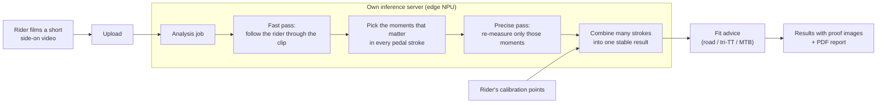
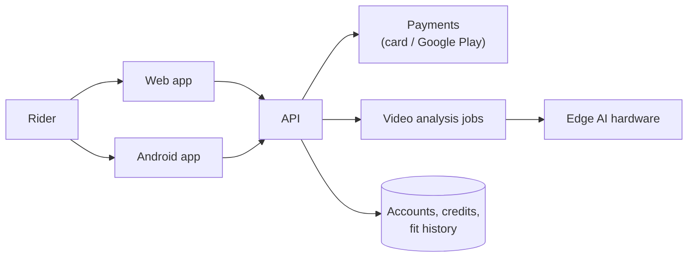
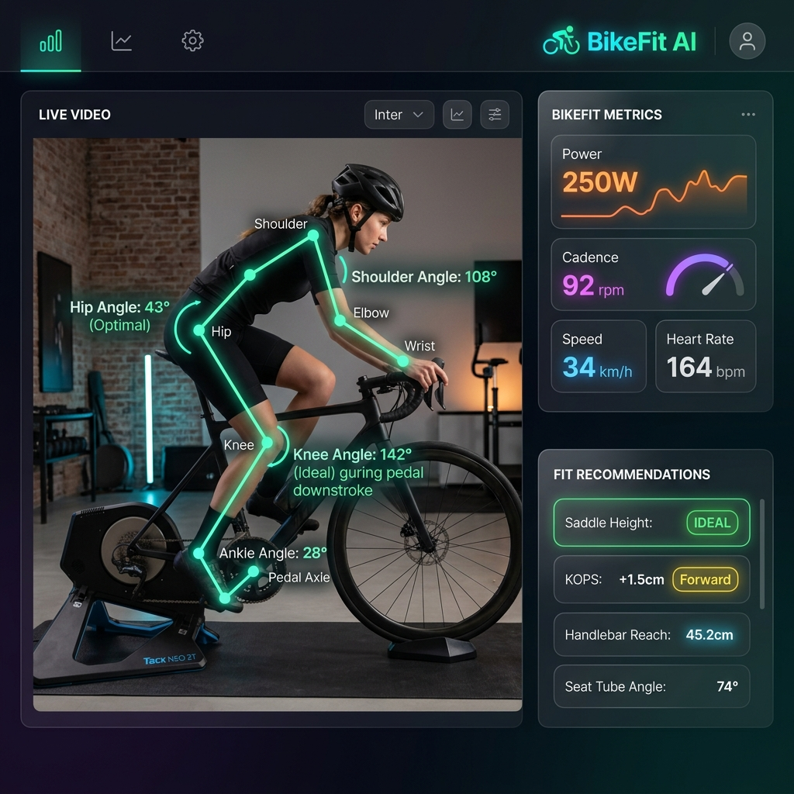
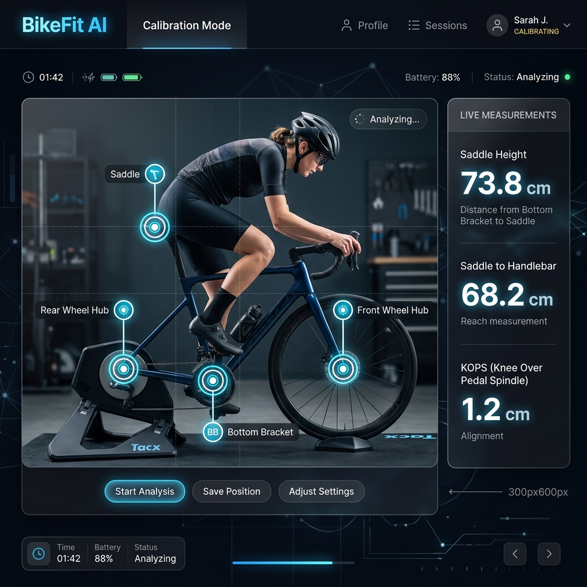

# BikeFit AI

> Video-based bike fitting: a rider films themselves pedalling on a trainer, and the system measures their position while they ride and turns it into clear, practical fit advice.

**Live product:** [bikefit.coachonurai.com](https://bikefit.coachonurai.com) · [Google Play](https://play.google.com/store/apps/details?id=com.trihonor.bikefitai)

**This is a documentation-only repository.** BikeFit AI is a commercial, closed-source product with paying users on the web and Android. I design, build and run it end to end. This repo is a high-level case study for recruiters and engineers. It contains no source code, no implementation details, no credentials and no user data.

---

## The problem

A professional bike fit means booking a fitter, a studio and a couple of hours. Most riders never do it. They ride slightly out of position for years and lose power, or end up with knee or back pain.

Most of what a fitter looks at (knee angle at the bottom and the top of the pedal stroke, hip angle, back angle, where the knee sits over the pedal) can be read from a side-on video. The hard part is doing it accurately enough to trust, cheaply enough to offer to everyone, and in a way a rider can check with their own eyes.

## What it does

- **Measures the rider while they pedal**, not in a frozen pose. Results come from many pedal strokes, not a single frame, so one bad frame cannot change the advice.
- **Works in real units.** The rider marks a few reference points on their bike once; from then on saddle height and knee-over-pedal position are reported in centimetres.
- **Gives advice the way a fitter would**: graded by how far a value is from the ideal range, specific to the bike type (road, triathlon/TT, MTB), and honest when a measurement is uncertain.
- **Shows its work.** Every key measurement comes with the exact frame it was taken from and the lines it was measured on, so the rider can see that the result is real.
- **Produces a report** the rider can keep or send to their own fitter, in 10 languages.
- **Runs on the web and on Android** from one code base, with paid analysis credits on both platforms.

## How it works (high level)

## Engineering decisions worth calling out

**Edge inference instead of a cloud GPU.** Video analysis runs on my own small server with a neural accelerator. Running costs stay flat as usage grows, and raw rider videos never leave infrastructure I control.

**Two passes: fast first, precise where it matters.** A fast model follows the rider through the whole clip. A slower, more precise model is spent only on the few moments that decide the fit. Accuracy goes where it counts, and analysis time stays at a couple of minutes.

**Many strokes, not one frame.** A rider's position changes a little from one pedal stroke to the next, and any single frame can be blurred or blocked by the bike. The result is built from many strokes with outliers removed, so the same video gives the same answer every time.

**Measure, don't assume, and check against data.** Clever-looking correction rules can quietly make things worse. I keep a shadow mode that compares models on real analyses, and I re-run thousands of stored, consented frames whenever the logic changes. One of those back-tests found that an old "self-correcting" rule was itself the source of wrong readings in some frames. It was removed, and that class of error disappeared.

**Show the evidence to the user.** Measurements are drawn on the exact frame they come from. When an input is weak (for example, a calibration point is missing), the app says the value is an estimate instead of presenting it as fact.

**Advice that matches how fitters work.** Recommendations are graded ("slightly high, optional small change" vs. "adjust and re-test"), depend on the bike type, and stay within what a side-on video can honestly show. Anything that needs a front view or pressure data is clearly marked as out of scope.

**Pay only for a finished analysis.** Credits are spent only when an analysis completes, on both the web (card payments) and Android (Google Play Billing), with all purchases verified on the server.

**One web core, shipped to native.** The web app is the single source of truth and is packaged into the Android app, so there is one front end to maintain instead of two.

**Privacy by default.** Videos are deleted after analysis. Only frames from riders who opted in are kept, with faces blurred, and they are used to improve the analysis.

## Screenshots

  
  

## Stack

**Computer vision:** pose estimation models on an edge neural accelerator, OpenCV
**Backend:** Python, FastAPI, SQLite, background job queue
**Infrastructure:** self-hosted ARM server with an NPU, systemd, scheduled backups and monitoring
**Front end:** vanilla JavaScript web app, 10 languages
**Mobile:** Capacitor (Android), published on Google Play
**Payments:** Stripe (web), Google Play Billing (Android), server-side verification

## What this repo is (and isn't)

- **Is:** a case study showing how the product is designed and the reasoning behind it.
- **Isn't:** the source code, an install guide, or a description of the measurement methods. BikeFit AI is proprietary. See the live product at [bikefit.coachonurai.com](https://bikefit.coachonurai.com).

If you're an engineer or a hiring team and would like to talk through any of these decisions, feel free to reach out via my GitHub profile.
